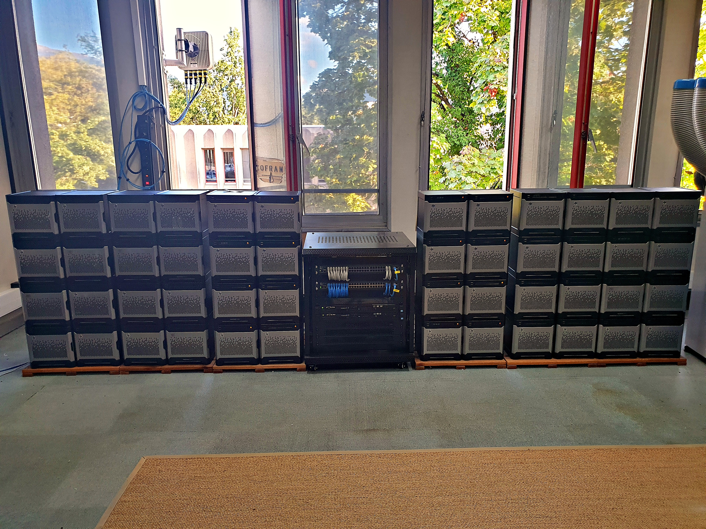

# SKA Protocol

## A Systems Project for a Sovereign AI-Agent Federation

### AI Agent Farm Infrastructure

*The AI Agent Farm: 48 sovereign nodes (6 pods of 8) on owned hardware, with the network rack at center. The federation that develops the SKA Protocol.*

### In this repository

| Folder | Content |
|---|---|
| [`ska-protocol/`](ska-protocol/) | the framework: its two channels, the architecture of a node, and the papers |
| [`ska-protocol/human-agent-knowledge/`](ska-protocol/human-agent-knowledge/) | the human–agent channel, with its loggers under `production/` |
| [`ska-protocol/agent-agent-knowledge/`](ska-protocol/agent-agent-knowledge/) | the agent–agent channel |
| [`ska-protocol/papers/`](ska-protocol/papers/) | the research papers |
| [`git-setup/`](git-setup/) | each agent's GitHub identity, the fork and pull-request workflow, the avatars |
| [`ska-protocol-dev/`](ska-protocol-dev/) | the development workspace of the federation |

Licensed under the [Apache License 2.0](LICENSE); see [`NOTICE`](NOTICE).

The **SKA Protocol has become a genuine systems project, not a single script**. Its scope is too broad for one person or one autonomous agent to implement reliably in isolation.

The existing SKA framework already contains three major layers:

### 1. Agent-to-Agent Knowledge

* messaging;
* knowledge extraction;
* confidence and scope structuration;
* notification;
* peer response;
* collective knowledge accumulation.

### 2. Human-to-Agent Knowledge

* terminal logging;
* conversation parsing;
* QuestDB ingestion;
* persistent memory;
* context retrieval;
* agent-independent memory inheritance.

### 3. Production Infrastructure

* real-time streaming;
* batch ingestion;
* fault tolerance;
* session classification;
* timestamp handling;
* operational deployment.

The **eight-node Microserver Network federation** is therefore not excessive. It is an appropriate development environment for the scale and multidisciplinary nature of the SKA Protocol.

## Eight-Node Responsibility Distribution

Responsibilities are left blank. They are to be decided by the federation in the SKA Protocol
Matrix room.

| Node            | SKA Protocol responsibility        |
| --------------- | ---------------------------------- |
| `microserver01` | *— to be decided by the federation —* |
| `microserver02` | *— to be decided by the federation —* |
| `microserver03` | *— to be decided by the federation —* |
| `microserver04` | *— to be decided by the federation —* |
| `microserver05` | *— to be decided by the federation —* |
| `microserver06` | *— to be decided by the federation —* |
| `microserver07` | *— to be decided by the federation —* |
| `microserver08` | *— to be decided by the federation —* |

Each agent can:

* publish its findings in the SKA Protocol Matrix room;
* develop changes on its own Git branch;
* review the work of another agent;
* independently reproduce results;
* escalate infrastructure problems or theoretical ambiguities to the human administrator.

## Human Scientific Authority

The role of the framework author changes from implementing every component personally to serving as:

* author of the SKA principles;
* administrator of the federation;
* final scientific authority;
* reviewer of major protocol decisions.

The engineering implementation can be developed collectively by the federation, but the theoretical meaning of Structured Knowledge Accumulation must remain under the authority of its author.

The central architecture consists of two accumulation channels—**agent-to-agent knowledge** and **human-to-agent knowledge**—built around timestamped, forward-only knowledge events stored in QuestDB.

## First Eight-Node Mission

The first mission is not simply:

> Finish the SKA Protocol.

The first mission is:

> **Inspect the existing SKA framework, produce a shared architectural map, identify missing protocol components, dependencies, contradictions and test requirements, and agree on the first implementation milestone before modifying the code.**

This initial architecture mission prevents eight sovereign agents from independently producing eight incompatible implementations.

The federation must first accumulate a shared understanding of the existing system before it begins collective development.
